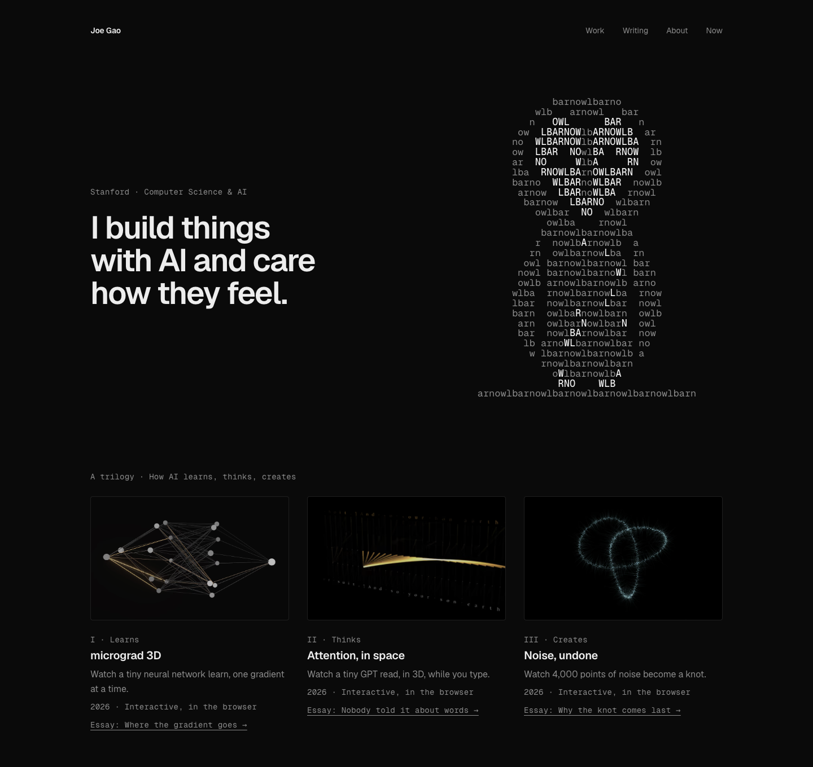

# joe-site



Joe Gao's personal site: the work, how each piece was made, and short essays on what building them taught me. Static [Astro](https://astro.build), no client-side framework, dark and light themes.

## Run it

Requires Node 22.23.4 or newer.

```bash
npm install
npm run dev        # http://localhost:4321
npm test           # production build + structural check of dist/
npm run build      # static site into dist/
```

## Pages

| Page | Source |
|---|---|
| Home: the owl, the trilogy (how AI learns, thinks, creates), research (how AI sees scale), then stories | `src/pages/index.astro` |
| Work: every piece with its case study | `src/pages/work.astro` |
| Writing: an intro and three essays, one per trilogy piece | `src/pages/writing/`, essays in `src/content/writing/` |
| About, Now | `src/pages/about.astro`, `src/pages/now.astro` |

## How it is put together

- **Works** live in one list, `src/data/works.ts`; Home and Work render whatever is there, in order. Every sentence of copy comes from the piece's own README or spec, nothing invented; measured numbers say which machine and browser they were measured on. The header of that file explains how to add a work.
- **Essays** are a content collection (`src/content.config.ts`). An essay marked `draft: true` shows a DRAFT mark and is `noindex`.
- **The owl** is plain text (`src/data/owl.txt`), generated by `node scripts/owl.mjs`: a barn owl whose heart-shaped face is lit, drawn out of the letters of "barn owl".
- **Design tokens** (colour, type, spacing) are in `src/styles/global.css`. Fonts are Geist and Geist Mono, self-hosted through Fontsource.
- **Checks**: `npm test` builds the site and runs `scripts/check-site.mjs` over `dist/` (every page has a title, description, `<h1>` and real alt text; no broken internal links; no placeholder text). Lighthouse, mobile and desktop: performance, accessibility and best practices median 100 on every page; SEO 100 everywhere except the Writing pages, which are `noindex` while they are drafts.

## Status

Not deployed yet. The Writing section is a draft until its first-person lines are approved.

## License

The code is MIT. See [LICENSE](LICENSE). The writing, images and owl mark are © Joe Gao, all rights reserved. Geist is under the SIL Open Font License.

Built with Claude.
